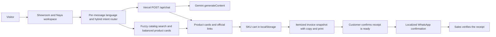

# INFORMA Sun City Sidoarjo | Naya Sales Agent

> **Unofficial Concept Demo.** This portfolio prototype is not an official INFORMA sales channel. Product prices are reference snapshots. Branch inventory, payment, and delivery require seller confirmation.

[Live Demo](https://demo-informa-suncity.vercel.app/)

## Overview

Naya is a **Zero-Deflection Digital-Human Sales Agent** for INFORMA Sun City Mall Sidoarjo. Naya guides product discovery, comparisons, Build My Room, and checkout in one conversation. The UI defaults to English and supports Indonesian through the language toggle or `?lang=id`. The chat detects the language of each message. The local router handles common English and Indonesian shopping requests, including furniture typos and requests for multiple product types. For free-form consultation, Gemini follows the language of the latest message or the customer's explicit language request. Sharing a name is optional.

The interactive cart persists by SKU and quantity and restores prices from the catalog. Returning visitors with saved items can reopen their cart or start a new order. Checkout creates an itemized invoice with a reference number, copy and print actions, and an option to edit before handoff. After the customer confirms their receipt is ready, the WhatsApp link opens a prefilled order message for sales. Customers send the message and attach the receipt in WhatsApp. **Finish Shopping** clears the current cart, invoice draft, and chat session.

## Architecture

## Guardrails

- Recommendation cards, links, SKUs, and invoice totals come from catalog records. The model cannot set prices, add discounts, or confirm stock.
- Gemini runs behind a server-side route. The API validates requests, limits upstream traffic, and checks for English/Indonesian language mismatches in those turns. The API key remains on the server.
- The receipt checkbox records customer confirmation. The site does not collect payment or attach files to WhatsApp. Sales verifies the receipt after the customer sends it.
- The room planner is a visual 2D composition tool. Product and lifestyle imagery comes from [INFORMA](https://informa.co.id/shop-the-look) and [Ruparupa](https://www.ruparupa.com/informastore/). Rights remain with their respective owners.

## Tech stack

- Vanilla HTML, CSS, and JavaScript for the showroom, chat, planner, and checkout
- Three.js and GSAP for showroom visuals and transitions
- Node.js for local development and Vercel for static assets and `/api/chat`
- Google Gemini REST API for free-form consultation. Deterministic shopping intents use the local catalog.

## Local setup

1. Install Node.js 22 or later and run `npm ci`.
2. Set `GEMINI_API_KEY` in the server process environment. Set `GEMINI_MODEL` only to override the default `gemini-2.5-flash`. On Windows, the existing local credential helper can supply the key.
3. Run `npm start` and open [localhost:4173](http://localhost:4173/). Use `PORT` to select another port.
4. Run `npm test` for regressions and `npm run build` to generate the static assets in `dist/`. Configure Gemini variables in the Vercel project environment so `/api/chat` can access them at runtime.

## Credits

**Developer** · Adi Nugroho (Mochammad Fajar Adi)

**Studio** · Extreme Studios AI

[GitHub](https://github.com/Extreme-Studios) · [LinkedIn](https://www.linkedin.com/in/adi-nugroho-1a819a378/) · [Email](mailto:3xtremestudios@gmail.com)
